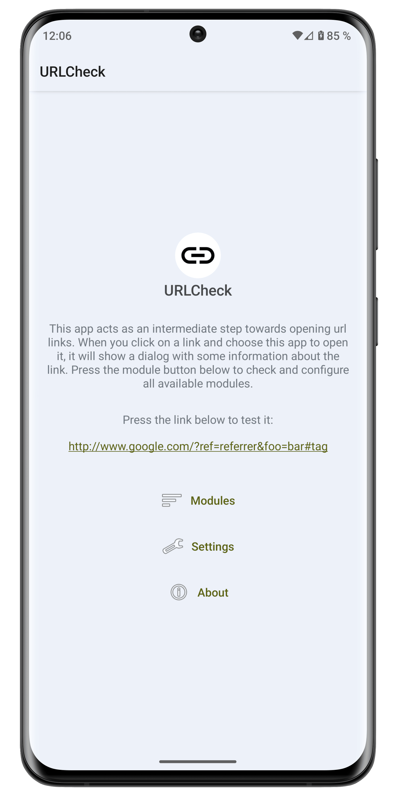
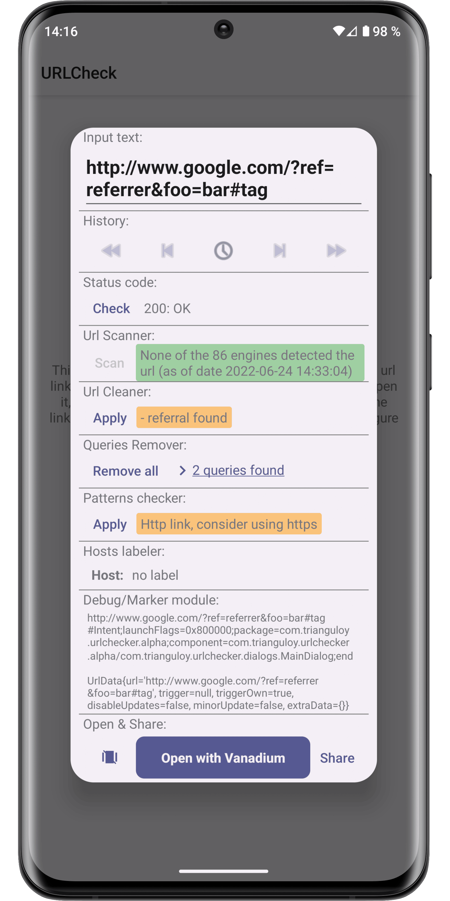
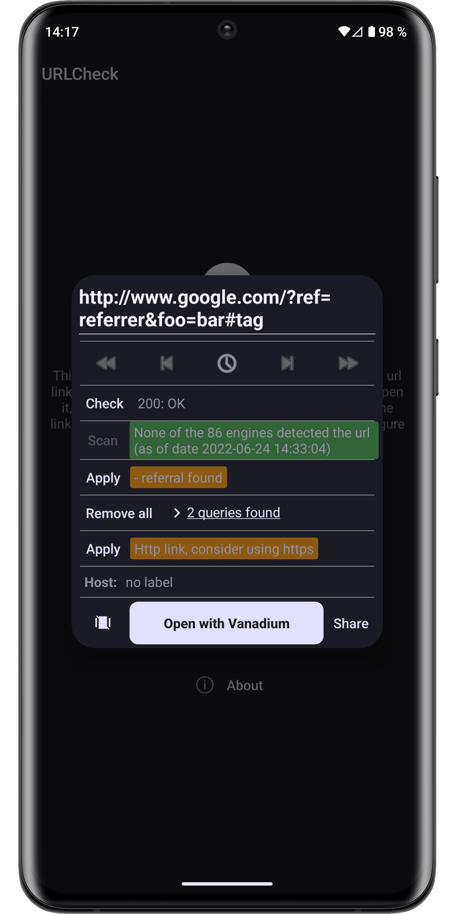
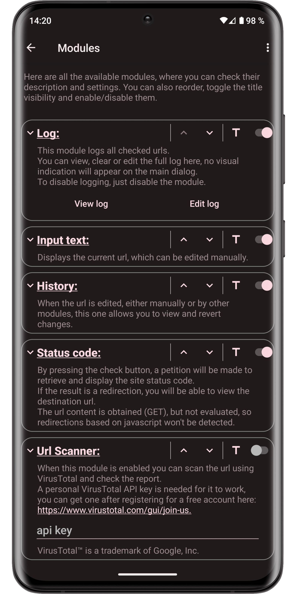
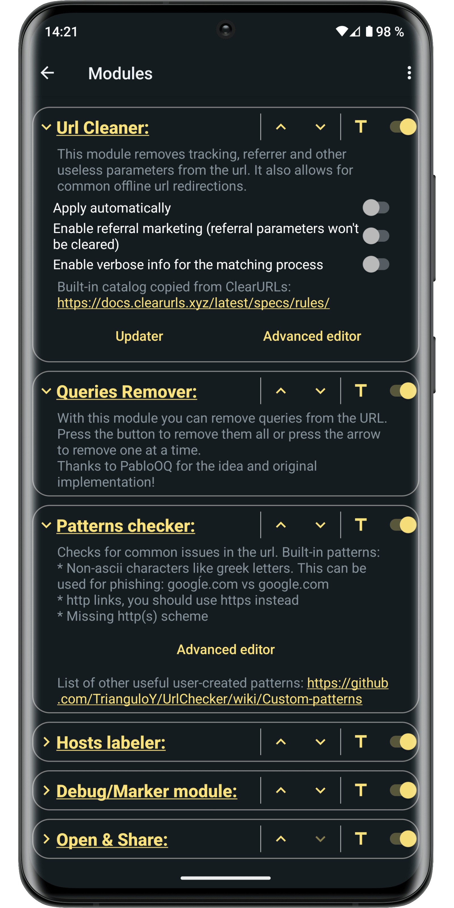
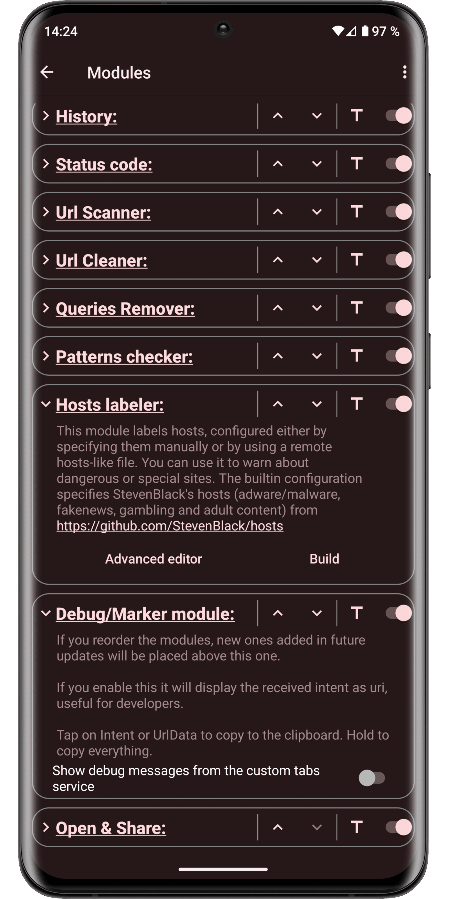
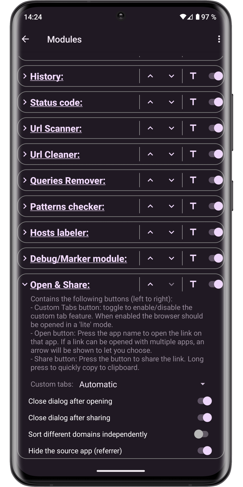
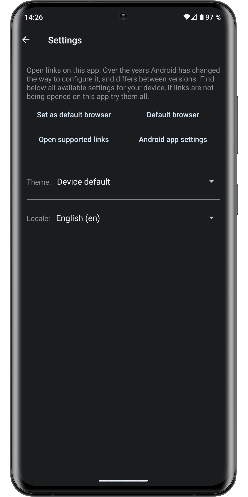

<div align="center">

<!-- ---------- Header ---------- -->


<!-- title -->
# URL Shield

<hr width="50%">


<hr>

<!-- ---------- Description ---------- -->
**URL Shield** acts as an amazingly customizable and powerful intermediary when opening url links, allowing, among other things:
to remove trackers, affiliate links, unnecessary elements, check Hosts, facilitating link holding and sharing, protecting against certain phishing techniques and many more...


<!-- ---------- Screenshots ---------- -->

<!--
<div style="display: flex;">
  
  
  
  
  
  
  
  
</div>

-->

**URL-Shield** is a lightweight, open-source tool designed to enhance web security by protecting URLs against malicious access and potential threats. It acts as a proxy layer, leveraging proof-of-work to verify legitimate traffic, ensuring your web services stay safe from unauthorized access and DDoS attacks.

</div>

## Features
- **URL Protection**: Validates incoming requests to prevent malicious access.
- **Proof-of-Work Verification**: Ensures only authorized users access your services.
- **Lightweight & Scalable**: Easily deployable via Docker for rapid setup.
- **Customizable**: Configure settings to suit your security needs.

## Installation

### Prerequisites
#### To build and run URL-Shield, ensure you have the following installed:
- **Android Studio**: Latest stable version (e.g., Android Studio Koala or newer).
- **Java**: JDK 17 or higher (compatible with Android development).
- **Android SDK**: API Level 21 (Android 5.0) or higher, configured in Android Studio.
- **Gradle**: Included with Android Studio, or ensure compatibility with the project’s Gradle version.
- **Git**: For cloning the repository.
#### Optional:
- Android Emulator or a physical Android device (running Android 5.0 or above) for testing.
- Redis: For enhanced performance if the app uses a backend caching layer (configure in .env).

### Steps
1. **Clone the Repository**:
   ```bash
   git clone https://github.com/amitskr/URL-Shield.git
   cd URL-Shield
   ```

## Usage
- Access your protected web service via the URL-Shield proxy.
- Configure proof-of-work settings in `.env` to adjust verification difficulty.
- Monitor traffic and logs to ensure optimal performance.

## Contributing
We welcome contributions! To get started:
1. Fork the repository.
2. Create a new branch (`git checkout -b feature/your-feature`).
3. Commit your changes (`git commit -m "Add your feature"`).
4. Push to the branch (`git push origin feature/your-feature`).
5. Open a Pull Request.

Please read our [Contributing Guide](CONTRIBUTING.md) for more details.

## License
This project is licensed under the MIT License. See the [LICENSE](LICENSE) file for details.

## Acknowledgments
- Built with ❤️ by [Viveka Jee](https://github.com/Vnjvibhash) & [amitskr](https://github.com/amitskr).

